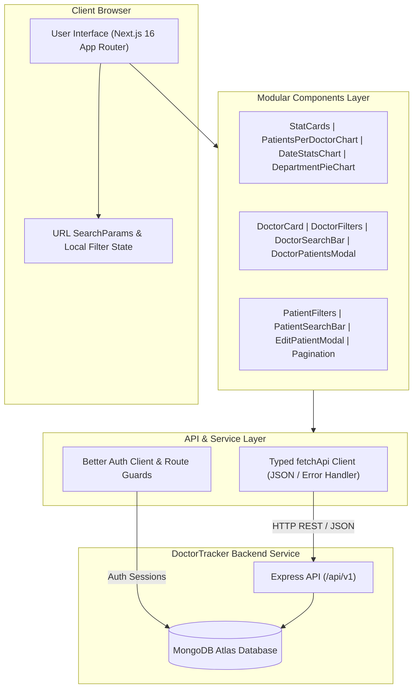
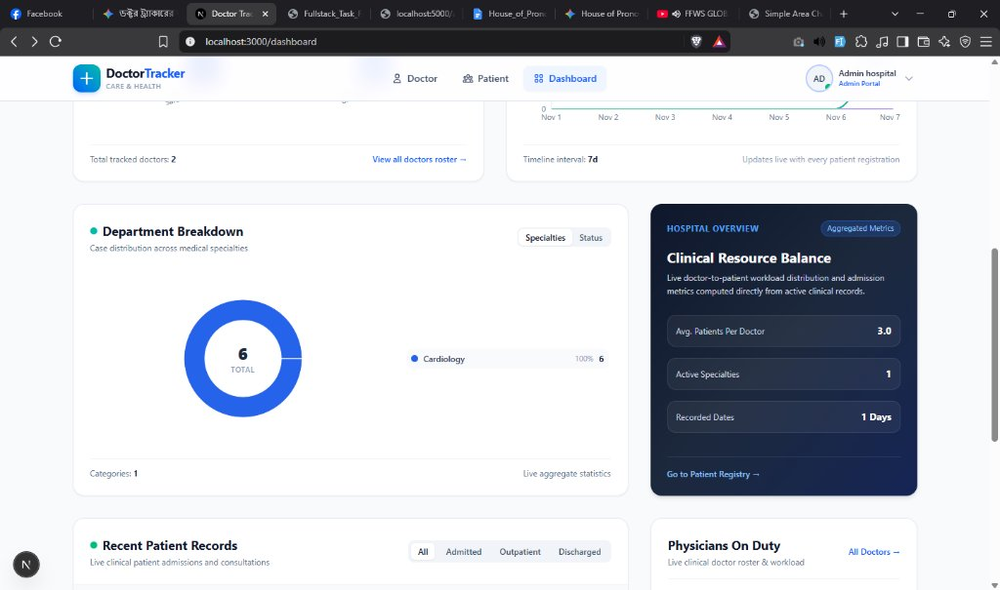

# 🏥 DoctorTracker — Frontend Web Application

> **Clinical Operations & Physician Roster Management Portal**

[](https://nextjs.org/)
[](https://www.typescriptlang.org/)
[](https://tailwindcss.com/)
[](https://recharts.org/)

---

## 📖 Description (Elevator Pitch)

**DoctorTracker** is a modern clinical management and operations portal that empowers healthcare administrators and hospital coordinators to streamline physician roster tracking, monitor patient admissions, and analyze workload distribution in real time. Built with Next.js 16 (App Router), Tailwind CSS, and Recharts, it eliminates clinical operational guesswork by visualizing doctor patient loads, tracking daily admission trends, and providing instant server-side filtering for rapid triage and seamless resource allocation.

---

## 🚀 Setup Guide

Follow these steps to set up and run the DoctorTracker frontend locally.

### Prerequisites

* **Node.js**: `v18.18.0` or higher (Node `v20+` recommended)
* **Package Manager**: `npm`, `pnpm`, or `yarn`
* **Backend API**: The `doctor-tracker-backend` service running on `http://localhost:5000`
* **MongoDB**: A local or MongoDB Atlas database URI for Better Auth authentication

### 1. Clone the Repository

```bash
git clone https://github.com/md-moynul/doctor-tracker.git
cd doctor-tracker
```

### 2. Install Dependencies

```bash
npm install
```

### 3. Configure Environment Variables

Create a `.env` file in the root of the `doctor-tracker` directory by copying `.env.example`:

```bash
cp .env.example .env
```

Your `.env` file must contain the following variables:

```env
# Next.js App Base URL
BETTER_AUTH_URL=http://localhost:3000

# Better Auth Secret Key (Generate using: openssl rand -base64 32)
BETTER_AUTH_SECRET=your_super_secret_better_auth_key_here

# MongoDB Database Connection String
MONGODB_URI=mongodb+srv://<username>:<password>@cluster0.mongodb.net/?retryWrites=true&w=majority

# Backend Express API Base URL
NEXT_PUBLIC_API_URL=http://localhost:5000/api/v1
```

### 4. Run the Development Server

```bash
npm run dev
```

Open [http://localhost:3000](http://localhost:3000) in your browser.

### 5. Production Build & Start

```bash
npm run build
npm start
```

---

## 🏛️ System Architecture

The frontend follows a modern, modular component architecture powered by Next.js 16 App Router with clean separation between UI presentation, stateful query synchronization, and data access layers.



### High-Level Data Flow:
1. **Routing & Navigation**: Client pages (`/dashboard`, `/doctors`, `/patients`) initialize with server-side query parameters reflected in the URL.
2. **Modular State**: Filters and search inputs trigger debounced URL updates, ensuring shareable, bookmarkable deep links.
3. **Data Fetching**: The lightweight `fetchApi` wrapper automatically serializes requests, handles credentials, and interacts with the Express backend REST endpoints.
4. **Analytics Rendering**: Recharts components dynamically ingest backend aggregation payloads to render responsive, GPU-accelerated SVG charts.

---

## 💡 Technical Decisions

### Decision 1: Server-Side Filtering & URL Query State vs. Client-Side State (Redux / Context)

* **Context & Challenge**: Hospitals frequently deal with hundreds to thousands of doctor and patient records across diverse departments, statuses (Admitted, Outpatient, Discharged), and dates. Storing entire datasets in client-side state (such as Redux or global React Context) would require downloading large JSON payloads, causing high initial load times and client-side memory bloat.
* **Why We Chose URL SearchParams + Server-Side Filtering**:
  1. **Zero Memory Bloat**: The client only loads the current paginated page (e.g., 6–10 records at a time) while the database handles indexed indexing and regex searching in milliseconds.
  2. **Shareable & Bookmarkable State**: Clinical staff can bookmark or copy-paste filtered links (e.g., `/patients?status=Admitted&department=Cardiology&page=2`) directly to colleagues, preserving exact filter states across sessions.
  3. **Reduced JavaScript Bundle**: Eliminating heavy client-side state managers like Redux or Zustand saved over 40KB of client runtime JS.

### Decision 2: Recharts for Data Visualization vs. Chart.js or D3.js

* **Context & Challenge**: The dashboard required interactive, live data visualization (Patients per Doctor bar charts, continuous 7–30 day admission timelines, and department specialty donuts) compatible with React 19 and Next.js App Router.
* **Why We Chose Recharts**:
  1. **Declarative Component Model**: Recharts components (`ResponsiveContainer`, `BarChart`, `AreaChart`, `PieChart`) follow idiomatic React JSX patterns rather than imperative canvas mutations like Chart.js or manual DOM node manipulation like D3.js.
  2. **Pure SVG Scalability & Custom Tooltips**: SVG elements scale crisply on high-DPI retina screens and mobile devices without pixelation. Custom tooltip components seamlessly render Tailwind CSS styles directly in React.
  3. **Native React 19 Compatibility**: Recharts v3 provides first-class support for modern React 19 client components without hydration mismatches.

---

## 📸 Visual Evidence

### Desktop Dashboard View
Real-time hospital operations showing metric cards, workload per doctor, admission trends, specialty distribution, and active clinical rosters:



### Key Features Demonstrated:
* **Metric Stat Cards**: Live counts of Total Doctors, Total Patients, Admitted Inpatients, and Outpatients.
* **Patients Per Doctor (Bar Chart)**: Visual workload distribution with quick toggles (Top 5, Top 8, All).
* **Date-Based Statistics (Area Chart)**: Smooth multi-series timeline for Total Visits, Inpatient Admissions, and Outpatient Visits across 7-day, 14-day, and 30-day windows.
* **Department Breakdown (Donut Chart)**: Dynamic clinical case classification by medical specialty.
* **Clinical Resource Balance**: Aggregated operational overview and patient-to-physician ratios.
* **Live Roster & Patient Tables**: Real-time consultation queue with interactive status filters.

---

## 🛠️ Tech Stack Summary

| Technology | Purpose |
| :--- | :--- |
| **Next.js 16 (App Router)** | Full-stack React framework with Turbopack |
| **TypeScript** | Strict type safety and predictable API contracts |
| **Tailwind CSS** | Utility-first styling with modern clinical color palette |
| **Recharts 3.x** | Composable SVG charting library for responsive analytics |
| **Better Auth** | Authentication with MongoDB adapter |
| **HeroUI Icons** | Accessible SVG iconography |
